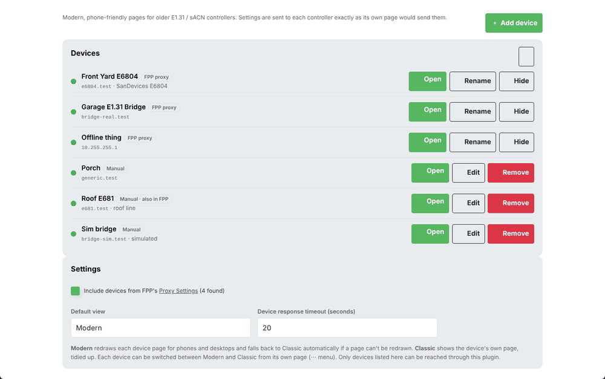
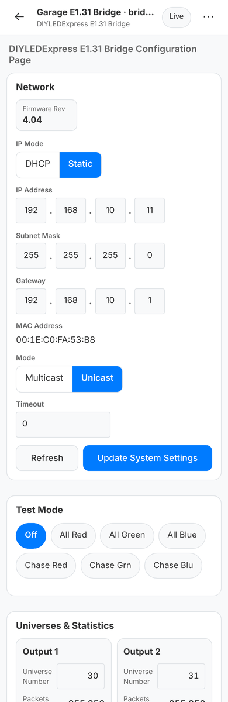
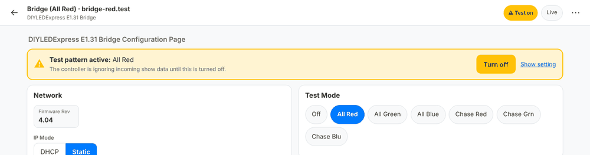
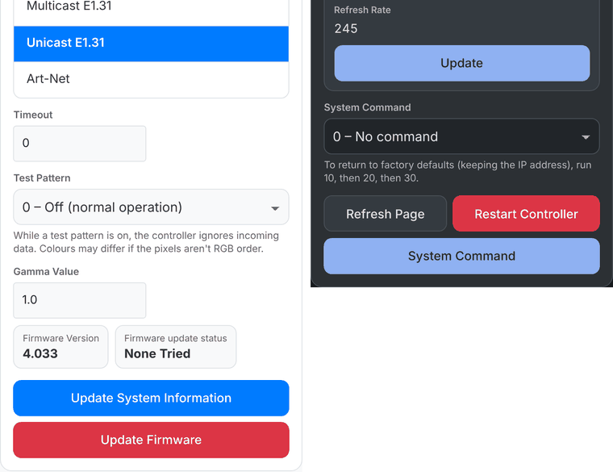

# Legacy Controller Proxy (fpp-legacy-proxy)

An FPP plugin that gives older E1.31 / sACN pixel controllers modern, phone-friendly web pages.

Many controllers' built-in pages no longer work properly in current browsers. Some send malformed HTTP headers, some use broken HTML, and none were built for phones. The plugin fetches a controller's page, redraws it, and sends your changes back **exactly as the controller's own page would**: same fields, same order, same encoding. Nothing on the controller changes.

Tested with:

- DIYLEDExpress E1.31 Bridge (firmware 4.04)
- SanDevices E6804 (firmware 4.081)
- SanDevices E681 (firmware 4.033)

Other controllers work through the generic engine. A page that can't be redrawn safely falls back to a tidied copy of the original automatically.



## Features

- **Device list on the plugin page:**
  - Add, edit and remove controllers, each with a one-tap **Open** link and an online/offline dot.
  - Controllers from FPP's **Proxy Settings** page appear automatically. You can rename or hide them here.
- **Modern view**, built for phones first and laid out for desktops:
  - IP addresses as `192 . 168 . 1 . 50` boxes; radio buttons as toggles.
  - Test modes as one-tap buttons.
  - One card per output or universe on phones; compact tables on desktop.
  - **Live** button that refreshes packet counters every 4 seconds while you test.
  - Unsaved changes are highlighted. Reboot, Restart and Firmware buttons ask for confirmation.
  - Pressing refresh after saving reloads the page instead of re-sending the command.
- **Test pattern alert:** a banner and a header badge whenever a controller's test pattern is on, with a **Turn off** button.
- **SanDevices code dropdowns:** Test Pattern and System Command codes are picked from labelled lists instead of typed from the manual.
- **Classic view:** the controller's own page, cleaned up. Switch per device from the ⋯ menu.
- Follows FPP's light and dark theme.

## Requirements

- FPP 10.0 or later (developed against 10.4).
- `python3` (preinstalled on FPP; listed as a dependency).
- No extra Python packages, services or open ports.

## Install

From FPP's Plugin Manager, use **Install from URL** with:

```
https://raw.githubusercontent.com/jcrossbdn/fpp-legacy-proxy/master/pluginInfo.json
```

Or manually, on the FPP box:

```bash
cd /home/fpp/media/plugins
git clone https://github.com/jcrossbdn/fpp-legacy-proxy.git
sudo chown -R fpp:fpp fpp-legacy-proxy
sudo fpp-legacy-proxy/scripts/fpp_install.sh
```

## Using the plugin

### Adding controllers

1. Open **Status/Control → Legacy Controller Proxy**.
2. Controllers already in FPP's **Proxy Settings** (Status/Control → Proxy Settings) are listed automatically and tagged **FPP proxy**. Use **Rename** to give one a friendlier name, or **Hide** to tuck it away. Hidden devices sit in a collapsed list at the bottom, where **Show** brings them back.
3. For any other controller, use **Add device**: a name, its IP address or host name, and optionally a port (default 80) and notes. These are tagged **Manual** and can be edited or removed.
4. If a manual device is also in FPP's Proxy Settings, it's listed once, tagged **Manual · also in FPP**.

Only controllers in this list can be reached through the plugin.

### Opening a controller

Tap **Open**. The page lives at `http://<fpp>/api/plugin/fpp-legacy-proxy/d/<controller-ip>/`, so you can bookmark it on your phone.



- **Saving:** each section has its own button (e.g. **Update System Settings**), exactly like the controller's own page. Changed fields are highlighted until you save.
- **Live:** turns on auto-refresh of read-only values such as Packets Received. It pauses while you're editing.
- **⋯ menu:** **Reload**, **Classic view** (show the controller's own page for this device) and **All devices**.
- **Back arrow:** returns to the device list.

### Test pattern alert

When a controller's test pattern or test mode is on, it ignores incoming show data. The page says so plainly:



- **Turn off** sets the test pattern to Off and saves that section. It sends exactly what choosing Off and pressing the section's button would. If you have unsaved edits in the same section, it takes you to the setting instead, so they aren't sent by surprise.
- **Show setting** scrolls to the test-pattern field.
- The **⚠ Test on** badge stays in the header while you scroll.

### SanDevices Test Pattern and System Command

The numeric code boxes are dropdowns. The labels come from the SanDevices manuals: [E6804 Operating Manual (firmware 4.026)](https://sandevices.com/wp-content/uploads/2017/11/E6804_Operating_Manual.pdf) and [E681 Operating Manual](https://sandevices.com/wp-content/uploads/2017/11/E681_Operating_Manual.pdf).



| Test Pattern | Meaning |
|---|---|
| 0 | Off (normal operation) |
| 1 / 2 / 3 | All red / green / blue |
| 4 / 5 / 6 | Chase: bright red / green / blue pixel over a dim background |
| 11–29 | RGB chase in groups of (code − 10), e.g. 15 = 5 red, 5 green, 5 blue |

| System Command | Meaning |
|---|---|
| 10 | Erase configuration memory (keeps the IP address) |
| 20 | Load test configuration (all outputs 2801, 50 pixels) |
| 30 | Load as-shipped defaults |

- To return to factory defaults while keeping the IP address, run 10, then 20, then 30.
- System Commands ask for confirmation first.
- A value the manuals don't document is kept and shown as "(not documented)"; the plugin never changes it.

### Modern and classic views

- **Modern** redraws the page; **Classic** shows the controller's own page, cleaned up, with FPP's theme.
- Set the default under **Settings** on the plugin page, or switch one device from its ⋯ menu.
- If a page can't be redrawn safely (frames, script-driven pages), it's shown in classic view automatically with a note explaining why.

### Settings

| Setting | What it does |
|---|---|
| Include devices from FPP's Proxy Settings | Merge FPP's proxy list into the device list (default on) |
| Default view | Modern or Classic for devices you haven't switched individually |
| Device response timeout | How long to wait for a slow controller (default 20 s) |

## Troubleshooting

| Symptom | What to check |
|---|---|
| **Device not responding** page | Is the controller powered and reachable from the FPP box? Try `curl -v http://<controller-ip>/` on the FPP. After a reboot, wait for it to come back. |
| **Device not in your list** page | Add it on the plugin page, or to FPP's Proxy Settings. |
| A save or setting shows an error | The message names the problem. Details are in `logs/plugin-fpp-legacy-proxy.log` (FPP's log folder). |
| Red **can't write to its data folder** banner | Reinstall the plugin from the Plugin Manager, or run `sudo scripts/fpp_install.sh` from the plugin folder. |
| A page looks wrong in Modern view | Switch that device to Classic (⋯ menu) and open an issue with the page source (Ctrl+U on the classic page). |

## Data and privacy

- **Storage:** devices, settings and per-device view choices are kept in `plugindata/fpp-legacy-proxy/config.json`. A Reinstall keeps them; Uninstall removes them.
- **Logs:** `logs/plugin-fpp-legacy-proxy.log`.
- **Network:** the plugin talks only to the controllers you list, or that are in FPP's Proxy Settings, on your network.
- **Access:** like FPP's own Proxy feature, anyone who can reach FPP's web UI can reach those controllers through it.

## Known limitations

- **Two reserved field names:** a controller form field literally named `uri` or `_method` would collide with FPP's API router. None of the tested controllers use these names.
- **Unsupported page types:** pages that use frames or depend on JavaScript are shown in the classic view.

## How it works

- `api.php` registers the plugin's routes under `/api/plugin/fpp-legacy-proxy/`. For a device page it:
  - checks the device is in your list;
  - fetches the page with a tolerant HTTP/1.0 client: one request at a time per controller, a short pause between requests, and bare-CR header lines accepted;
  - hands the HTML to the re-skin engine (`engine/`, Python standard library only).
- The engine parses forms and tables the way a browser does, including forms wrapped around table rows and unclosed tags. It redraws the page and re-emits every original field. `static/reskin.js` submits fields in the original document order and character set, so the controller receives the same request it would get from its own page.

| Route | Purpose |
|---|---|
| `GET devices` | Merged device list (yours + FPP Proxy Settings) |
| `POST devices`, `POST devices/delete` | Add/update, remove your devices |
| `POST devices/fpp` | Rename/hide an FPP-sourced device |
| `POST prefs` | Plugin settings (not `settings`: FPP owns `/plugin/<repo>/settings/…`) |
| `GET status/:target` | Quick reachability check |
| `GET live/:target?path=/` | Current read-only values (Live mode) |
| `GET view/:target/:mode` | Switch a device between modern and classic |
| `GET/POST d/:target/**` | The device's pages |

## Development notes

- **Help page:** `help/devices.php` renders this README in FPP's help dialog (F1 on the plugin page). Keep the README current and the help follows. Relative image and link paths work in both GitHub and FPP.
- **No mbstring:** FPP does not install PHP's `mbstring` extension, so PHP code must not use `mb_*` functions. Use `preg` with `/u`, as `LegacyProxy::cut()` and `toUtf8()` do. Test with `php -d disable_functions=mb_substr,mb_check_encoding,mb_convert_encoding,mb_strlen,utf8_encode`. Parsedown uses `mb_strlen()` on lines containing tabs, so the help page converts tabs to spaces before parsing.
- **Error handling:** every API route runs inside `flp_guard()`. An unexpected PHP error becomes a JSON error with status 500, plus a line in the plugin log. FPP's router would otherwise send it as a 200.
- **Route names:** FPP registers its own `/plugin/:RepoName/{icon,page,privacy,releaseNotes,settings,updates,upgrade}` routes first, and their `:params` are optional, so plugin routes must avoid those names.
- **Device profiles:** profiles in `engine/reskin.py` (`PROFILES`) only change wording and add code dropdowns (`choices`); layout is generic. Pull requests with captured pages from other controllers are welcome.

## License

MIT
